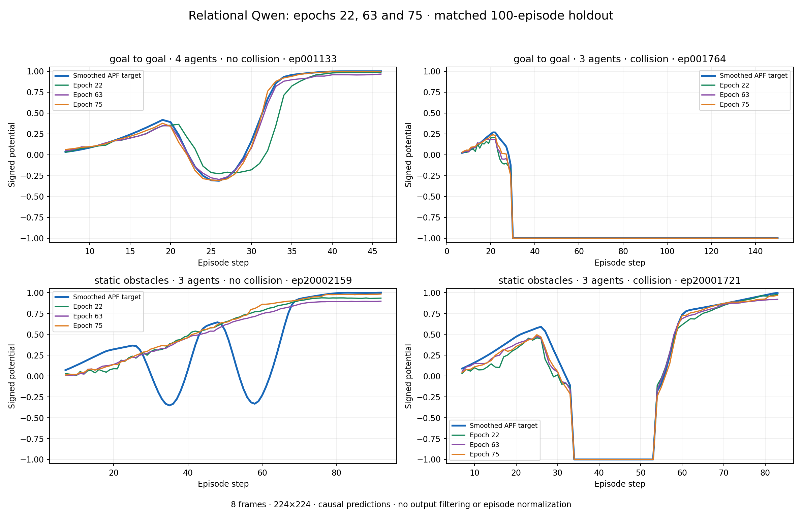
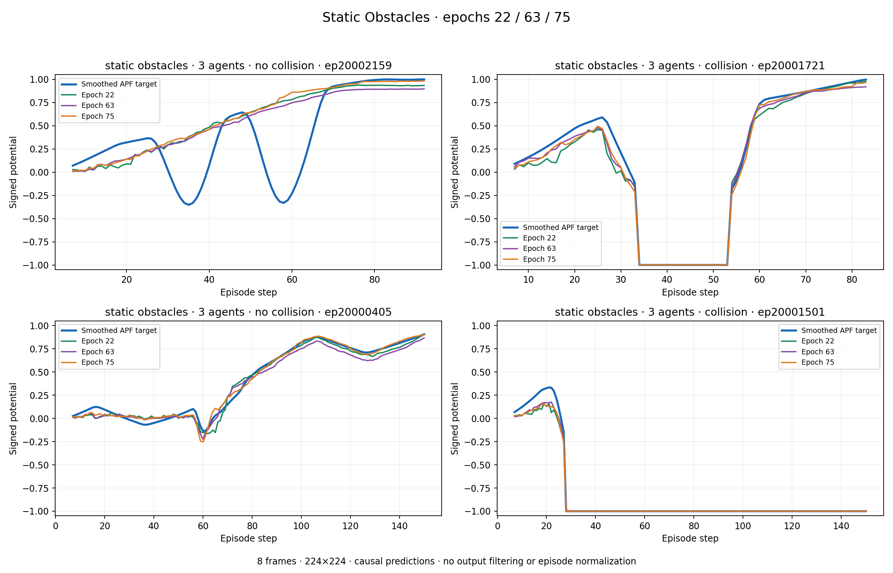

# Relational native224 inference and validation analysis

> **Input-contract limitation:** these checkpoints were trained and evaluated with current robot state appended to task text, including collision/reached flags. The metrics below describe that legacy input setting and do not validate a task-only vision-language critic. See the [input audit](../task_only_input_audit.md). Fresh training is required under the corrected task-only contract.

Training run: [relational_native224_2500_qwen3_vl_clip8_epoch75_20261012_20261013_010607](https://wandb.ai/i2rLAB/VLCM_Training_RWARE/runs/nku3ga22). Training job 17141648 completed all 75 epochs with exit 0:0.

| Checkpoint | Composite validation loss | Scalar validation MSE | Reward-drop direction recall | Recovery direction recall |
|---|---:|---:|---:|---:|
| Epoch 22 | 1.4185 | 0.03585 | 71.6% | 69.2% |
| Epoch 63 | 1.6697 | 0.01759 | 75.4% | 69.0% |
| Epoch 75 | 1.5953 | 0.02000 | 71.9% | 65.6% |

The growing training–validation gap supports overfitting in the composite objective, especially categorical CE. However, scalar value error improves well beyond epoch 22: epoch 63 has about 51% lower scalar validation MSE than epoch 22. Epoch 75 degrades about 14% relative to epoch 63. Select a critic using scalar and reward-change behavior on matched held-out episodes rather than total loss alone. These numbers are training-time validation logs, not the new inference results.

Completed comparison: preparation 17252650 → inference 17252651, one A100. Both finished with exit 0:0; inference took 1:04:37. Three exact checkpoints, 100 identical forward-only held-out episodes (50 GTG, 50 AO); GTG cardinality and five AO collection-policy strata represented. Same 8 frames and 224×224 inputs. Ground-truth labels retain training-time causal Gaussian smoothing; predictions receive no extra smoothing or within-episode normalization. Model weights must load strictly. VJEPA stays on standby.

The established `run_tb3_episode_inference_all.sh` launches each checkpoint. Outputs include `comparison_overview.png`, domain comparisons, per-episode plots/CSVs, and `metrics_summary.json`, with `EVALUATION_COMPLETE.json` written only after successful inference and finite-metric checks.

Remote output root: `/scratch/aparame/VLCM/ma_vlcm/evaluations/qwen_relational_native224_best_vs75_20261014`.

No training configuration was changed; no recurring monitor was reactivated.

## Completed inference conclusions

Epoch75 has lowest overall MAE (0.0550), GTG MAE (0.0270), and AO MAE (0.0830). Epoch63 has lower overall RMSE (0.1238 vs0.1310) and AO RMSE (0.1672 vs0.1791). Epoch75 GTG drop/recovery recalls are96.5%/97.9%, versus AO36.7%/86.0%. Epoch63 AO drop/recovery recalls are40.2%/89.5%.

All32 observed AO collision onsets are assigned negative potential by63 and75. However, for339 AO drops between adjacent non-collision frames, direction recall falls from41.3% (22) to34.5% (63) to30.7% (75). This is a material weakness for reward-driven obstacle avoidance despite good collision recognition and smooth plots. These rankings apply to the legacy state-augmented text contract. Neither checkpoint is validated for policy learning under the corrected task-only contract.

The earlier provisional preference for63 is refined by the full episode results:75 is better on GTG; AO shows a tradeoff. No policy training was launched.

